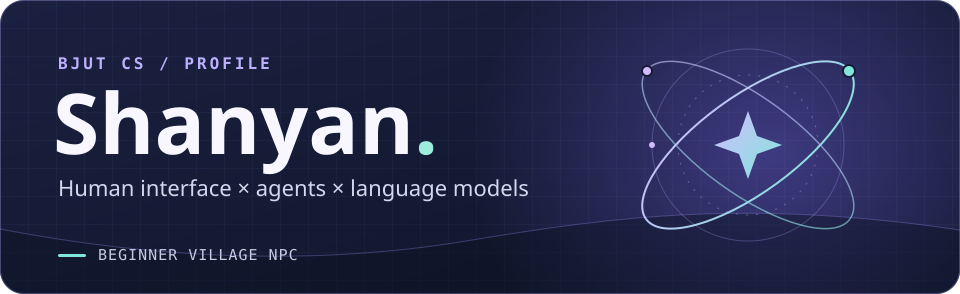
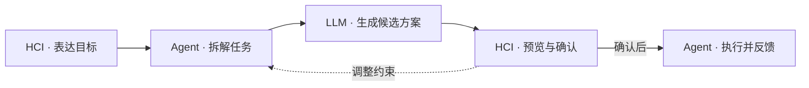
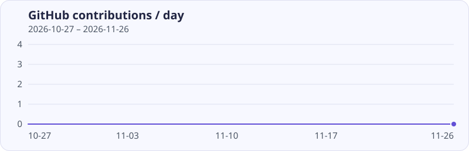

北京工业大学 · 计算机科学本科生 · 传奇新手村 NPC

不息为体，日新为道。

[交互实验室](#interaction-lab) · [贡献曲线](#contributions) · [每日诗笺](#daily-poem) · [学习资料](#learning-materials) · [联系我](#contact)

## Interaction Lab

**HCI × Agent × LLM** · 我关心的不只是模型能做什么，也关心人什么时候能看见、改动或叫停它的下一步。

### 走一遍交互｜学习路线助手（概念示例）

> 「我每天只有 30 分钟，想用两周入门 NLP。」

Agent 把目标拆成阅读、练习和复盘；LLM 根据时间预算拟出候选路线。界面先展示每天的安排和预计耗时，再由你决定下一步：

✓ 确认路线 · 展开查看反馈

Agent 保存已确认的安排，并回显第一天的任务：用 20 分钟了解分词，再用 10 分钟比较两种分词结果。

↺ 我想调整 · 展开查看反馈

如果你把周末设为休息日，界面会保留原方案，并标出重新分配的任务。新计划会再次请求确认，不会直接覆盖原安排。

**研究方向：** 人机交互（HCI）· 安全 · 机器人。坚定的冯诺伊曼派码农，喜欢把学到的东西整理成别人也能用的笔记。

## Contributions

**最近 31 天的 GitHub 每日贡献数。** 曲线随定时任务刷新，统计区间标在图上。

[前往 GitHub 个人概览查看贡献日历 ↗](https://github.com/Shan-yan?tab=overview)

## Daily Poem

**每日诗笺** · 给写代码的一天留几行诗。由 GitHub Actions 每日自动轮播，可[查看更新记录](https://github.com/Shan-yan/Shan-yan/actions/workflows/update-poem.yml)。

<!-- POEM-START -->
### 《虞美人·春花秋月何时了》

作者：李煜

> 雕栏玉砌应犹在，只是朱颜改。\
> 问君能有几多愁？恰似一江春水向东流。
<!-- POEM-END -->

## Learning Materials

整理自制的 BJUT 课内资料、AI 学习路线和阅读笔记。欢迎取用、参考和二次整理；找不到某份资料，也可以直接来信问我。

[逛逛公开仓库 ↗](https://github.com/Shan-yan?tab=repositories)

## Contact

欢迎聊课程、Agent、读到的好诗，也欢迎来信指正。

[2503701145@qq.com](mailto:2503701145@qq.com) · [在 GitHub 上找到我 ↗](https://github.com/Shan-yan)
